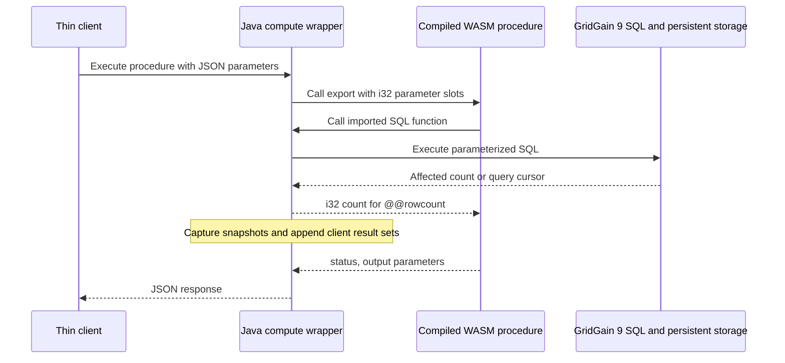

# Sybase WASM procedures on unmodified GridGain 9

This example uses the existing public compute and SQL APIs from `/Users/oscar/Projects/MariaDB/gridgain-9`. **No GridGain source modifications are required.** All example implementation code is in this directory.

The inventory procedures run inside the deployed Java compute job [`SybaseWasmJob`](src/main/java/example/sybase/SybaseWasmJob.java). It hosts their compiled WASM with Chicory and provides SQL callbacks through `context.ignite().sql()`. The self-contained `validate_restock` example also demonstrates GridGain's existing native `WASM_EMBEDDED` executor.

Inventory data lives in the GridGain 9 table `PUBLIC.GG9_WASM_INVENTORY`, using the **`aipersist` persistent storage engine**. The demo restarts the node and queries the same inventory again through the Java wrapper.

## Run

Prerequisites: JDK 21, the parent Python environment, and the local GridGain checkout.

```sh
cd /Users/oscar/Projects/WASM/Sybase/GG-9-WASM-Sybase
./run.sh
```

The script selects JDK 21 on macOS when `JAVA_HOME` is unset. It compiles the SQL and builds the example against the local GridGain source. The Gradle init script registers this external example for that build invocation; it does not edit GridGain settings or product source. Gradle writes its usual build outputs and caches.

The checkout's existing development license is read at startup. Set `GG_LICENSE=/path/to/gridgain-license.json` to supply your own valid license. `GG_SOURCE` and `PYTHON` can override the checkout and Python paths.

The demo uses loopback ports **33490** (network), **10890** (client), and **10390** (REST). It creates a fresh working directory under `build/node-<uuid>`, deploys `build/libs/sybase-wasm-jobs.jar` and `generated/validate_restock.wasm`, runs the checks, restarts that node to verify persistence, and shuts it down. Existing node/data directories are left intact; a new script run creates a separate fixture.

```text
ALL COMPUTE CHECKS PASSED (3 native + 8 Java-wrapper calls, including persistent data after restart)
```

[`build/demo-results.json`](build/demo-results.json) records the responses and the persistent data directory. Checks cover successful/invalid/missing-SKU restocks, output parameters, early returns, multiple result sets, an empty first result set, and a summary after restart.

Verified after restoring the wrapper: all 11 compute calls passed against unmodified GridGain 9, including the persistent-node restart. The GG9 source checkout remained clean, and existing data directories were preserved.

## Trace SQL, WASM variables and results

Tracing is **on by default in the demo**. Each Java-wrapper invocation prints one JSON event per line, prefixed with `[SYBASE-TRACE]`. The events appear as the call executes. `call_id` groups one invocation, `sequence` orders its events, and `node` and `procedure` identify the executing node and procedure. Separate invocations can interleave safely in the log.

Run and capture the output:

```sh
mkdir -p build
./run.sh 2>&1 | tee build/traced-demo.log
```

To view only the procedure trace, or only the summary calls:

```sh
rg '^\[SYBASE-TRACE\]' build/traced-demo.log
rg '^\[SYBASE-TRACE\].*"procedure":"inventory_summary"' build/traced-demo.log
```

| Event | What you see |
| --- | --- |
| `CALL_START` / `WASM_CALL` | Resolved parameter values, including defaults and initial output slots, followed by the WASM argument slots |
| `SQL_START` | The actual SQL submitted to GridGain 9, its bound values, import name, kind, and a per-invocation `sql_call` number; snapshot placeholders are already expanded |
| `SQL_END` | `affected_rows` for an update or `row_count` for a query |
| `SNAPSHOT` | Internal temporary rows and columns captured for `#stock` |
| `HOST_RETURN` | The i32 row count returned by the SQL callback to WASM |
| `ROWCOUNT_SET` | The value being assigned to WASM's `@@rowcount` local, including resets performed by control flow |
| `OUTPUT_SET` | An assignment to an output parameter inside WASM, such as `@matches = 2` |
| `RESULT_SET` | One client result set, with its one-based index, column names and complete rows; empty sets are included |
| `WASM_RETURN` / `OUTPUT` | Raw return values such as `[0,2]`, followed by each named output parameter |
| `CALL_END` | Return status, final outputs, SQL call count and client result-set count |
| `SQL_ERROR` / `CALL_ERROR` | Failure details; the original error still fails the compute job |

For `inventory_summary(minimum=1)` after the restock, these are excerpts from the event payloads (the shared correlation fields and intervening events are omitted):

```json
{"event":"SQL_START","operation":"snapshot_0","kind":"snapshot","sql_call":1,"sql":"SELECT i.sku, SUM(i.quantity) AS available FROM GG9_WASM_INVENTORY AS i GROUP BY i.sku HAVING SUM(i.quantity) >= CAST(? AS INT)","parameters":[1]}
{"event":"SQL_END","sql_call":1,"row_count":2}
{"event":"HOST_RETURN","sql_call":1,"operation":"snapshot_0","i32":2}
{"event":"ROWCOUNT_SET","variable":"@@rowcount","value":2}
{"event":"OUTPUT_SET","variable":"@matches","value":2}
{"event":"ROWCOUNT_SET","variable":"@@rowcount","value":1}
{"event":"ROWCOUNT_SET","variable":"@@rowcount","value":0}
{"event":"RESULT_SET","sql_call":2,"index":1,"columns":["SKU","AVAILABLE","STOCK_LEVEL"],"rows":[[101,22,"ready"],[202,3,"low"]]}
{"event":"WASM_RETURN","values":[0,2]}
{"event":"OUTPUT","parameter":"@matches","value":2}
{"event":"CALL_END","status":0,"outputs":{"matches":2},"sql_call_count":2,"result_set_count":1}
```

The row-count resets to 1 and 0 come from the compiled assignment and `IF`; they do not indicate additional SQL calls. The second `SQL_START` line shows the full `VALUES` query and the captured row values bound to it. In `inventory_results`, the second query produces one row, so the final `@@rowcount` is 1 while `@matches` still holds the first query's count. With `minimum=99`, its first `RESULT_SET` has `rows: []` and its second has `rows: [[0,99]]`. An early-returning summary emits no `RESULT_SET`. An invalid restock emits no SQL events and ends with `sql_call_count: 0`.

`ROWCOUNT_SET` and `OUTPUT_SET` use Chicory's existing interpreter execution listener and the local names embedded in the generated WASM. They observe the stack value immediately before `local.set`/`local.tee` executes, without changing the stack or binary. Keep the WASM name section generated by `prepare.py` for local-variable tracing. The wrapper's normal response format stays the same.

Disable tracing for the whole demo:

```sh
SYBASE_TRACE=false ./run.sh
```

For your own compute request, enable it per call with the Boolean `trace` field; omitting it defaults to off:

```json
{"procedure":"inventory_summary","parameters":{"minimum":1},"trace":true}
```

Tracing prints complete bound values and result rows to the executing node's standard output. In this embedded demo that is the same console as the client. With a separate cluster, read that node's logs; trace events are not added to the compute response. The trace covers SQL issued by the wrapper, rather than the demo's fixture setup or the standalone native validator.

The trace verifier uses only Python's standard library and checks the captured events against the demo responses, including actual WASM assignments, ordered empty sets, snapshot bindings and skipped SQL:

```sh
python3 verify_trace.py build/traced-demo.log
SYBASE_TRACE=false ./run.sh > build/untraced-demo.log 2>&1
python3 verify_trace.py build/untraced-demo.log --disabled
```

Verification captured **113 ordered trace events across eight Java-wrapper calls**. All 11 demo compute checks and the persistent-node restart passed with tracing both enabled and disabled. The disabled run emitted no trace events, and the GG9 source checkout remained clean.

## Calling the Java wrapper

```java
var descriptor = JobDescriptor.<String, String>builder("example.sybase.SybaseWasmJob")
        .units(new DeploymentUnit("sybase-wasm-example", "1.0.0"))
        .options(JobExecutionOptions.builder().maxRetries(0).build())
        .build();

String response = client.compute().execute(target, descriptor,
        "{\"procedure\":\"inventory_summary\",\"parameters\":{\"minimum\":1}}");
```

The wrapper accepts the three bundled inventory procedures. Omitted parameters use their declared defaults; omitted output slots use their default or zero. Inputs are signed 32-bit integers. Each call receives its own WASM instance, temporary snapshots and result buffers.

## SQL → AST → WASM → GridGain

[`prepare.py`](prepare.py) reuses the parent [Lark parser](../ase_parser.py) and [compiler](../compiler.py). It compiles these procedures:

| Source | Execution path | Behavior |
| --- | --- | --- |
| [`validate_restock.sql`](sql/validate_restock.sql) | Native `WASM_EMBEDDED` | `IF` and scalar status |
| [`restock.sql`](../restock.sql) | Java wrapper hosting WASM | `UPDATE` and `@@rowcount` |
| [`inventory_summary.sql`](../examples/inventory_summary.sql) | Java wrapper hosting WASM | Temporary snapshot, output parameter, result set |
| [`inventory_results.sql`](../examples/inventory_results.sql) | Java wrapper hosting WASM | Output parameter and two ordered result sets |

The [`generated`](generated/) directory contains ASTs, readable WAT, WASM binaries, ABI manifests and SQL bindings. The wrapper JAR packages the WASM, ABI and bindings as resources. The adapter maps inventory to the sample GridGain table and replaces the Ignite 2 snapshot syntax with a parameterized `VALUES` relation for GridGain 9.



## Output parameters and multiple result sets

The fixture contains two lots of SKU 101 with quantities 7 and 5, SKU 202 with quantity 3, and SKU 303 with quantity 0. `restock(101,5)` increments **each matching lot**, producing an aggregate of 22. GridGain returns `affectedRows() = 2`; the wrapper returns 2 through the WASM import into `@@rowcount`. A missing SKU returns 0 affected rows and procedure status 2. Invalid quantities return status 1 before SQL execution.

After restocking, `inventory_summary` returns:

```json
{
  "node": "sybase-wasm-node",
  "status": 0,
  "outputs": {"matches": 2},
  "result_sets": [
    {
      "columns": ["SKU", "AVAILABLE", "STOCK_LEVEL"],
      "rows": [[101, 22, "ready"], [202, 3, "low"]]
    }
  ]
}
```

The snapshot query returns two groups. Its callback returns 2 to WASM, `SELECT @matches = @@rowcount` sets the output local, and the export returns `[0,2]`. The wrapper names those values using the ABI. The final query uses the captured snapshot rather than rereading live inventory.

Each executed client-facing `SELECT` appends a result set in order. Assignments, internal snapshots and skipped statements append none. An executed empty query still includes its column metadata. For `inventory_results` with `minimum=99`:

```json
{
  "node": "sybase-wasm-node",
  "status": 0,
  "outputs": {"matches": 0},
  "result_sets": [
    {"columns": ["SKU", "AVAILABLE"], "rows": []},
    {"columns": ["MATCHING_SKUS", "REQUESTED_MINIMUM"], "rows": [[0, 99]]}
  ]
}
```

`inventory_summary(minimum=99)` takes its early return: status 2, `matches=0`, and no result sets.

## Scope

The unmodified native WASM executor in this checkout does not expose these SQL callbacks. The inventory examples therefore use the Java compute wrapper; their procedure control flow still executes as WASM, and the database remains GridGain 9.

The compiler retains the parent project's supported Sybase subset. Snapshot cells support INT/BIGINT/NULL. The wrapper buffers results for these small examples; large or streaming results require a different transport. It is intended for the bundled modules and is outside the native WASM executor's resource controls.

SQL statements use implicit GridGain transactions. There is no procedure-wide rollback or exactly-once guarantee. SQL failures fail the compute call; earlier committed statements remain committed. Compute retries are disabled, and application retries after an uncertain write outcome can still duplicate an increment. Full ASE session semantics, nested procedures and TDS result tokens remain outside this proof of concept.
