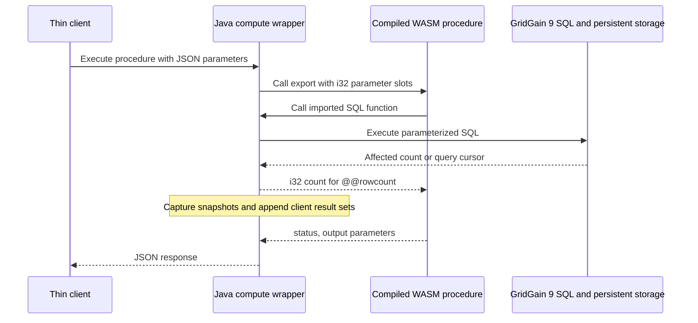

# Sybase WASM procedures on unmodified GridGain 9

This example uses the existing public compute and SQL APIs from `/Users/oscar/Projects/MariaDB/gridgain-9`. **No GridGain source modifications are required.** The wrapper and demos live here; the shared typed compiler is in `../gg9_compiler.py`.

The inventory and Customer 360 procedures run inside the deployed Java compute job [`SybaseWasmJob`](src/main/java/example/sybase/SybaseWasmJob.java). It hosts their compiled WASM with Chicory and provides SQL callbacks through `context.ignite().sql()`. The self-contained `validate_restock` example also demonstrates GridGain's existing native `WASM_EMBEDDED` executor.

Inventory data lives in the GridGain 9 table `PUBLIC.GG9_WASM_INVENTORY`, using the **`aipersist` persistent storage engine**. The demo restarts the node and queries the same inventory again through the Java wrapper.

## Run

Prerequisites: JDK 21, the parent Python environment, and the local GridGain checkout.

```sh
cd /Users/oscar/Projects/MariaDB/sybase-cdc/WASM/Sybase/GG-9-WASM-Sybase
./run.sh
```

The script selects JDK 21 on macOS when `JAVA_HOME` is unset. It compiles the SQL and builds the example against the local GridGain source. The Gradle init script registers this external example for that build invocation; it does not edit GridGain settings or product source. Gradle writes its usual build outputs and caches.

The checkout's existing development license is read at startup. Set `GG_LICENSE=/path/to/gridgain-license.json` to supply your own valid license. `GG_SOURCE` and `PYTHON` can override the checkout and Python paths.

The demo uses loopback ports **33490** (network), **10890** (client), and **10390** (REST). It creates a fresh working directory under `build/node-<uuid>`, deploys `build/libs/sybase-wasm-jobs.jar` and `generated/validate_restock.wasm`, runs the checks, restarts that node to verify persistence, and shuts it down. Existing node/data directories are left intact; a new script run creates a separate fixture.

```text
ALL COMPUTE CHECKS PASSED (3 native + 8 Java-wrapper calls, including persistent data after restart)
```

[`build/demo-results.json`](build/demo-results.json) records the responses and the persistent data directory. Checks cover successful/invalid/missing-SKU restocks, output parameters, early returns, multiple result sets, an empty first result set, and a summary after restart.

Verified after restoring the wrapper: all 11 compute calls passed against unmodified GridGain 9, including the persistent-node restart. The GG9 source checkout remained clean, and existing data directories were preserved.

## Trace SQL, WASM variables and results

Tracing is **on by default in the demo**. Each Java-wrapper invocation prints one JSON event per line, prefixed with `[SYBASE-TRACE]`. The events appear as the call executes. `call_id` groups one invocation, `sequence` orders its events, and `node` and `procedure` identify the executing node and procedure. Separate invocations can interleave safely in the log.

Run and capture the output:

```sh
mkdir -p build
./run.sh 2>&1 | tee build/traced-demo.log
```

To view only the procedure trace, or only the summary calls:

```sh
rg '^\[SYBASE-TRACE\]' build/traced-demo.log
rg '^\[SYBASE-TRACE\].*"procedure":"inventory_summary"' build/traced-demo.log
```

| Event | What you see |
| --- | --- |
| `CALL_START` / `WASM_CALL` | Resolved parameter values, including defaults and initial output slots, followed by the WASM argument slots |
| `SQL_START` | The actual SQL submitted to GridGain 9, its bound values, import name, kind, and a per-invocation `sql_call` number; snapshot placeholders are already expanded |
| `SQL_END` | `affected_rows` for an update or `row_count` for a query |
| `SNAPSHOT` | Internal temporary rows and columns captured for `#stock` |
| `HOST_RETURN` | The i32 row count returned by the SQL callback to WASM |
| `ROWCOUNT_SET` | The value being assigned to WASM's `@@rowcount` local, including resets performed by control flow |
| `OUTPUT_SET` | An assignment to an output parameter inside WASM, such as `@matches = 2` |
| `RESULT_SET` | One client result set, with its one-based index, column names and complete rows; empty sets are included |
| `WASM_RETURN` / `OUTPUT` | Raw return values such as `[0,2]`, followed by each named output parameter |
| `CALL_END` | Return status, final outputs, SQL call count and client result-set count |
| `SQL_ERROR` / `CALL_ERROR` | Failure details; the original error still fails the compute job |

For `inventory_summary(minimum=1)` after the restock, these are excerpts from the event payloads (the shared correlation fields and intervening events are omitted):

```json
{"event":"SQL_START","operation":"snapshot_0","kind":"snapshot","sql_call":1,"sql":"SELECT i.sku, SUM(i.quantity) AS available FROM GG9_WASM_INVENTORY AS i GROUP BY i.sku HAVING SUM(i.quantity) >= CAST(? AS INT)","parameters":[1]}
{"event":"SQL_END","sql_call":1,"row_count":2}
{"event":"HOST_RETURN","sql_call":1,"operation":"snapshot_0","i32":2}
{"event":"ROWCOUNT_SET","variable":"@@rowcount","value":2}
{"event":"OUTPUT_SET","variable":"@matches","value":2}
{"event":"ROWCOUNT_SET","variable":"@@rowcount","value":1}
{"event":"ROWCOUNT_SET","variable":"@@rowcount","value":0}
{"event":"RESULT_SET","sql_call":2,"index":1,"columns":["SKU","AVAILABLE","STOCK_LEVEL"],"rows":[[101,22,"ready"],[202,3,"low"]]}
{"event":"WASM_RETURN","values":[0,2]}
{"event":"OUTPUT","parameter":"@matches","value":2}
{"event":"CALL_END","status":0,"outputs":{"matches":2},"sql_call_count":2,"result_set_count":1}
```

The row-count resets to 1 and 0 come from the compiled assignment and `IF`; they do not indicate additional SQL calls. The second `SQL_START` line shows the full `VALUES` query and the captured row values bound to it. In `inventory_results`, the second query produces one row, so the final `@@rowcount` is 1 while `@matches` still holds the first query's count. With `minimum=99`, its first `RESULT_SET` has `rows: []` and its second has `rows: [[0,99]]`. An early-returning summary emits no `RESULT_SET`. An invalid restock emits no SQL events and ends with `sql_call_count: 0`.

`ROWCOUNT_SET` and `OUTPUT_SET` use Chicory's existing interpreter execution listener and the local names embedded in the generated WASM. They observe the stack value immediately before `local.set`/`local.tee` executes, without changing the stack or binary. Keep the WASM name section generated by `prepare.py` for local-variable tracing. The wrapper's normal response format stays the same.

Disable tracing for the whole demo:

```sh
SYBASE_TRACE=false ./run.sh
```

For your own compute request, enable it per call with the Boolean `trace` field; omitting it defaults to off:

```json
{"procedure":"inventory_summary","parameters":{"minimum":1},"trace":true}
```

Tracing prints complete bound values and result rows to the executing node's standard output. In this embedded demo that is the same console as the client. With a separate cluster, read that node's logs; trace events are not added to the compute response. The trace covers SQL issued by the wrapper, rather than the demo's fixture setup or the standalone native validator.

The trace verifier uses only Python's standard library and checks the captured events against the demo responses, including actual WASM assignments, ordered empty sets, snapshot bindings and skipped SQL:

```sh
python3 verify_trace.py build/traced-demo.log
SYBASE_TRACE=false ./run.sh > build/untraced-demo.log 2>&1
python3 verify_trace.py build/untraced-demo.log --disabled
```

Verification captured **113 ordered trace events across eight Java-wrapper calls**. All 11 demo compute checks and the persistent-node restart passed with tracing both enabled and disabled. The disabled run emitted no trace events, and the GG9 source checkout remained clean.

## Calling the Java wrapper

```java
var descriptor = JobDescriptor.<String, String>builder("example.sybase.SybaseWasmJob")
        .units(new DeploymentUnit("sybase-wasm-example", "1.0.0"))
        .options(JobExecutionOptions.builder().maxRetries(0).build())
        .build();

String response = client.compute().execute(target, descriptor,
        "{\"procedure\":\"inventory_summary\",\"parameters\":{\"minimum\":1}}");
```

The wrapper accepts the three bundled inventory procedures. Omitted parameters use their declared defaults; omitted output slots use their default or zero. Inputs are signed 32-bit integers. Each call receives its own WASM instance, temporary snapshots and result buffers.

## SQL → AST → WASM → GridGain

[`prepare.py`](prepare.py) reuses the parent [Lark parser](../ase_parser.py) and [compiler](../compiler.py). It compiles these procedures:

| Source | Execution path | Behavior |
| --- | --- | --- |
| [`validate_restock.sql`](sql/validate_restock.sql) | Native `WASM_EMBEDDED` | `IF` and scalar status |
| [`restock.sql`](../restock.sql) | Java wrapper hosting WASM | `UPDATE` and `@@rowcount` |
| [`inventory_summary.sql`](../examples/inventory_summary.sql) | Java wrapper hosting WASM | Temporary snapshot, output parameter, result set |
| [`inventory_results.sql`](../examples/inventory_results.sql) | Java wrapper hosting WASM | Output parameter and two ordered result sets |

The [`generated`](generated/) directory contains ASTs, readable WAT, WASM binaries, ABI manifests and SQL bindings. The wrapper JAR packages the WASM, ABI and bindings as resources. The adapter maps inventory to the sample GridGain table and replaces the Ignite 2 snapshot syntax with a parameterized `VALUES` relation for GridGain 9.



## Output parameters and multiple result sets

The fixture contains two lots of SKU 101 with quantities 7 and 5, SKU 202 with quantity 3, and SKU 303 with quantity 0. `restock(101,5)` increments **each matching lot**, producing an aggregate of 22. GridGain returns `affectedRows() = 2`; the wrapper returns 2 through the WASM import into `@@rowcount`. A missing SKU returns 0 affected rows and procedure status 2. Invalid quantities return status 1 before SQL execution.

After restocking, `inventory_summary` returns:

```json
{
  "node": "sybase-wasm-node",
  "status": 0,
  "outputs": {"matches": 2},
  "result_sets": [
    {
      "columns": ["SKU", "AVAILABLE", "STOCK_LEVEL"],
      "rows": [[101, 22, "ready"], [202, 3, "low"]]
    }
  ]
}
```

The snapshot query returns two groups. Its callback returns 2 to WASM, `SELECT @matches = @@rowcount` sets the output local, and the export returns `[0,2]`. The wrapper names those values using the ABI. The final query uses the captured snapshot rather than rereading live inventory.

Each executed client-facing `SELECT` appends a result set in order. Assignments, internal snapshots and skipped statements append none. An executed empty query still includes its column metadata. For `inventory_results` with `minimum=99`:

```json
{
  "node": "sybase-wasm-node",
  "status": 0,
  "outputs": {"matches": 0},
  "result_sets": [
    {"columns": ["SKU", "AVAILABLE"], "rows": []},
    {"columns": ["MATCHING_SKUS", "REQUESTED_MINIMUM"], "rows": [[0, 99]]}
  ]
}
```

`inventory_summary(minimum=99)` takes its early return: status 2, `matches=0`, and no result sets.

## Inventory ABI v1 scope

The unmodified native WASM executor in this checkout does not expose these SQL callbacks. The inventory examples therefore use the Java compute wrapper; their procedure control flow still executes as WASM, and the database remains GridGain 9.

The original inventory ABI v1 retains the parent project's integer subset. The Customer 360 ABI v2 described below has broader support. Snapshot cells support INT/BIGINT/NULL. The wrapper buffers results for these small examples; large or streaming results require a different transport. It is intended for the bundled modules and is outside the native WASM executor's resource controls.

SQL statements use implicit GridGain transactions. There is no procedure-wide rollback or exactly-once guarantee. SQL failures fail the compute call; earlier committed statements remain committed. Compute retries are disabled, and application retries after an uncertain write outcome can still duplicate an increment. This describes the original inventory ABI v1; ABI v2 supports the explicit transactions and nested call in `03_procs.sql`. Full ASE session semantics and TDS result tokens remain outside both backends.


## Run every procedure in `03_procs.sql`

The typed backend compiles all **six** procedures directly from
[`sybase/sql/03_procs.sql`](../../../sybase/sql/03_procs.sql). It does not replace their
bodies with handwritten Java business logic. The Java wrapper implements a shared
host interface for SQL, typed values, transactions, identity allocation and cursors.
WASM executes the statement sequence, conditional branches, loop and returns.
SQL expressions, including branch predicates, are evaluated by GridGain SQL. This
keeps SQL decimal/NULL behavior in the SQL engine but adds round trips even for
local expressions; it is a compatibility proof of concept, not a performance
benchmark or a standalone SQL-free WASM module.

```sh
cd /Users/oscar/Projects/MariaDB/sybase-cdc/WASM/Sybase/GG-9-WASM-Sybase
mkdir -p build
./run_customer360.sh 2>&1 | tee build/customer360.log
```

This runs the inventory regression checks plus the Customer 360 workflow and a typed
roundtrip procedure. It creates a disposable GridGain node with persistent storage,
deploys the wrapper JAR, exercises the jobs through the thin client compute API,
restarts that node, checks the customer data again, then stops it. There are **40
client compute invocations**: the original 11, 23 additional successful or
business-error responses, and six expected failed jobs. Nested procedure execution
adds a WASM invocation within its parent job. `build/demo-results.json` contains
all returned responses; trace logs contain the expected failures as well.

The fixture uses the column types and primary keys in
[`01_schema.sql`](../../../sybase/sql/01_schema.sql), translated by `prepare.py` into
[`generated/customer360-schema.sql`](generated/customer360-schema.sql). This is a
**demo schema**, not a complete schema migration: foreign keys, indexes, ASE defaults
and triggers are not reproduced. Seed rows are explicit. Customer, order, product,
payment, loyalty and score data all reside in GridGain 9 tables.

| Procedure | Compiled behavior exercised on GridGain |
| --- | --- |
| `sp_recalc_loyalty_tier` | Decimal spend aggregate, date filter, subquery lookup, nullable VARCHAR locals and `@new_tier OUTPUT`, conditional update and missing-customer error |
| `sp_customer_360` | `NOT EXISTS`, joins, `TOP` → `LIMIT`, aggregates, CASE, SELECT assignment, **six ordered result sets**, empty sets and NULL cells |
| `sp_create_order` | Default string parameter, INSERT, generated identity and `@order_id OUTPUT`, inactive-customer error |
| `sp_add_order_item` | Decimal multiplication, conditional stock UPDATE, `@@rowcount`, explicit commit/rollback, validation errors; an injected duplicate-key SQL failure verifies rollback of the preceding stock change |
| `sp_complete_order` | Multiple variable assignments, decimal-to-integer truncation, transactional order/payment/points writes, nested call to compiled `sp_recalc_loyalty_tier` |
| `sp_score_customers` | Nullable datetime defaults, a forward-only cursor, `FETCH`/`@@sqlstatus`, a WASM `loop`, CASE scoring, update-then-insert and grouped summary |

The fixture creates order **101**, adds two items at **75.25**, completes it at
**150.50**, awards **150** points, and promotes the customer to **SILVER** after
including prior completed spend of 4900. The score checks exercise a customer with
orders (25/LOW), one without orders (90/HIGH), a repeated UPDATE, and an empty cursor.
These checks passed on the local unmodified GridGain checkout on 2026-11-18.
Equivalence against an executing SAP ASE server has **not** been tested.

Compile the complete script without starting GridGain:

```sh
cd /Users/oscar/Projects/MariaDB/sybase-cdc/WASM/Sybase
.venv/bin/python compiler.py ../../sybase/sql/03_procs.sql \
  --target gridgain9 --schema ../../sybase/sql/01_schema.sql \
  --out GG-9-WASM-Sybase/generated
.venv/bin/python -m unittest discover -v
```

Each procedure produces `.ast.txt`, `.wat`, `.wasm`, `.abi.json` and `.bindings.json`.
`USE` and guarded `DROP PROCEDURE` batches are deployment scaffolding and are not
executed. Other unsupported statements fail compilation. The original default
`--target ignite2` and its Python runtime retain the inventory ABI v1.

## Typed ABI v2 and data types

WASM has no native SQL DECIMAL, VARCHAR, datetime or NULL type. ABI v2 uses
**invocation-local i32 handles** into Java values. Handle **0 means SQL NULL**;
a handle containing integer zero is a separate nonzero handle. Parameters, locals,
identity values and output parameters use handles. Return status, `@@rowcount`,
`@@sqlstatus` and predicate booleans are unboxed i32 values. Handles are neither
pointers nor serialized data, and are discarded when the job ends.

The ABI declares each variable's ASE type and its GridGain binding type. Every
SQL placeholder has an explicit cast. A host call dereferences its input handles,
uses Java values with the SQL API, and registers returned values as new handles.
Assignments preserve a variable's previous value when their SELECT returns no
rows; otherwise they use the last row, coerced to the declared type. Uninitialized
locals and omitted output parameters are NULL. Defaults apply only to omitted inputs.

| ASE types | GridGain / Java representation | JSON representation |
| --- | --- | --- |
| `tinyint`, `smallint`, `int`, `integer`, `bigint`, unsigned integer variants | Range-checked SMALLINT/INT/BIGINT; unsigned BIGINT uses DECIMAL(20,0) | Small integers are numbers; BIGINT/unsigned BIGINT are strings to preserve all digits |
| `bit` | SMALLINT constrained to 0 or 1; boolean input accepted | 0/1 |
| `numeric`, `decimal`, `dec`, `money`, `smallmoney` | DECIMAL / BigDecimal, up to precision 38; money scale 4 and ASE money bounds | Decimal strings; no conversion through double |
| `real`, `float`, `double precision` | REAL/Float or DOUBLE/Double; finite values only | JSON numbers |
| `char`, `varchar`, `nchar`, `nvarchar`, `unichar`, `univarchar`, `text`, `unitext`, `sysname`, `longsysname` | VARCHAR/String; declared length checked, fixed CHAR values space-padded | Unicode strings |
| `binary`, `varbinary`, `image`, `timestamp` | VARBINARY/byte[]; fixed binary zero-padded; ASE timestamp is eight binary bytes | `0x` hexadecimal strings |
| `date` | DATE/LocalDate | ISO date, e.g. `2024-02-29` |
| `time`, `bigtime` | TIME(6)/LocalTime | ISO local time |
| `datetime`, `smalldatetime`, `bigdatetime` | TIMESTAMP(6)/LocalDateTime | ISO local datetime, without a timezone |
| SQL NULL | Handle 0 / Java null | JSON null |

The mapping covers ordinary scalar transport and the six procedures, **not every
ASE type's storage semantics**. ASE datetime tick rounding, smalldatetime minute
rounding/ranges, server charset/collation, native text/image locator semantics,
and automatic row-version updates for `timestamp` are not emulated. LOBs are
buffered values, not streamed locators. Empty strings normalize to one blank;
`text_locator` accepts the materialized representation described below. User-defined datatypes need an explicit
mapping and currently fail compilation. Input integer overflow, fractional integer
inputs, excess decimal scale, invalid binary strings and oversized strings fail the
job rather than silently losing data. Assignment decimal scaling uses HALF_UP;
`CONVERT(int, expression)` truncates toward zero.

[`typed_roundtrip.sql`](sql/typed_roundtrip.sql) tests actual SQL callbacks and WASM
outputs for 18 parameters, including `numeric(38,9)`, maximum signed/unsigned BIGINT,
Unicode, binary, microsecond time, fixed CHAR padding and NULL. For example:

```json
{
  "procedure": "typed_roundtrip",
  "parameters": {
    "big": "9223372036854775807",
    "huge": "18446744073709551615",
    "amount": "12345678901234567890123456789.123456789",
    "text_value": "日本語 – café",
    "bytes": "0x00feff",
    "instant": "2026-11-18T12:34:56.123456"
  },
  "trace": true
}
```

## Output parameters, errors and multiple results in ABI v2

Submit the same public Java compute descriptor as the inventory examples, with
`procedure` set to one of the bundled names. For example:

```json
{"procedure":"sp_create_order","parameters":{"customer_id":1},"trace":true}
```

Its WASM export returns `(status, order_id_handle)`. Java dereferences that handle
(the timing block is omitted from these response excerpts):

```json
{"node":"sybase-wasm-node","status":0,"outputs":{"order_id":101},"result_sets":[],"messages":[]}
```

`sp_recalc_loyalty_tier` returns a string output in the same envelope:

```json
{"node":"sybase-wasm-node","status":0,"outputs":{"new_tier":"SILVER"},"result_sets":[],"messages":[]}
```

`sp_customer_360` returns six entries in `result_sets`, in source order: profile,
order summary, recent orders, category spend, interactions and loyalty position.
Each entry has `columns` and positional `rows`. Executed empty SELECTs remain in
that list. Internal SELECT assignments, predicates and cursor queries do not add
client result sets. Decimal and BIGINT cells follow the encoding table above.
The nested procedure shares its parent's result/message collector; it runs another
compiled WASM export within the same Java compute job.

For a missing customer, RAISERROR is recorded separately from the explicit RETURN:

```json
{
  "node":"sybase-wasm-node","status":-1,"outputs":{},"result_sets":[],
  "messages":[{"procedure":"sp_customer_360","number":20002,"message":"Customer not found"}]
}
```

This is a JSON contract, not an ASE/TDS exception/severity implementation. The
source's RAISERROR is nonfatal to the host and the following WASM RETURN supplies
its status. Actual GridGain SQL errors and type-validation failures fail the compute
call; active explicit transactions are rolled back on exit.

## Transactions, identities and tracing in ABI v2

SQL callbacks use the public API:

```java
context.ignite().sql().execute(transaction, context.cancellationToken(), sql, args.toArray());
```

The `gridgain-9.2.0` branch runs procedures containing BEGIN TRAN or nested EXEC in
one read/write transaction from the start. COMMIT TRAN is deferred until the whole
call succeeds; ROLLBACK undoes earlier writes in that call, including writes before
BEGIN TRAN. A nested-call failure can therefore undo an earlier logical COMMIT.
These boundaries differ from ASE. Returning with an open BEGIN is rejected and
rolled back. Standalone SELECT callbacks use a short read/write transaction to
observe writes made by another client immediately before job submission. Other
standalone statements use implicit transactions.

Identity INSERTs allocate from the shared `id_seq` table in zone `c360_ref`, using
the same counter names as the phase2 jobs. A separate committed, retried transaction
advances each counter; failed inserts can leave gaps. An absent counter begins at
1,000,000,000 to avoid the CDC range. The isolated embedded fixtures explicitly
seed their counters to the next available test ID, so their examples still return
101. This supports single-row INT identities; it does not implement arbitrary ASE
identity/session settings or triggers. Customer 360 INSERTs also supply the
GridGain `customer_id` colocation key for `order_item` and `payment`.

Tracing retains `[SYBASE-TRACE]` and adds typed details:

- `SQL_START` shows the expanded SQL, decoded parameters and whether the call uses
  a supplied transaction (including wrapper-managed reads); `SQL_END` shows rows or `affected_rows`.
- `HOST_RETURN.wasm_values` shows raw handles/counts. For assignment the tuple is
  `(assigned_handles..., rowcount)`; for an identity INSERT it is `(rowcount, identity_handle)`.
- `ROWCOUNT_SET` observes WASM storing the raw affected count. IF reads that count
  through its predicate callback before setting it to zero.
- `OUTPUT_SET` and `OUTPUT` show both the handle and decoded value, including NULL.
- `TRANSACTION`, `IDENTITY`, `CURSOR_FETCH` (including `sqlstatus` 0 or 2), `RAISERROR`,
  `EXECUTE_PROCEDURE` and `EXECUTE_RETURN` expose the remaining runtime effects.
  A nested call has its own `call_id`, linked by `child_call_id`.

```sh
python3 verify_customer360.py build/customer360.log
python3 verify_trace.py build/customer360.log  # original inventory regression trace
rg '^\[SYBASE-TRACE\].*"procedure":"sp_add_order_item"' build/customer360.log
rg '^\[SYBASE-TRACE\].*"event":"(OUTPUT|RESULT_SET|CURSOR_FETCH|TRANSACTION)"' build/customer360.log
SYBASE_TRACE=false ./run_customer360.sh
```

The typed runtime is for small, trusted bundled procedures. It buffers up to 10,000
rows per SQL result/cursor, allows 100,000 value handles, 20,000 SQL calls and a
maximum nested-call depth of 32, and checks job cancellation. The cursor is a
materialized forward-only snapshot in one job, not a distributed ASE cursor. It
is outside the native WASM executor's fuel/memory controls. No automatic compute
retry or exactly-once guarantee is supplied. Nested BEGIN, savepoints, dynamic SQL,
GOTO, `@@error`, positional EXEC output/status capture, triggers, session state and
full dialect compatibility remain unsupported. The original inventory snapshot
support remains in ABI v1; ABI v2 does not yet implement `SELECT INTO #temp`.

For broader compatibility work, see the downloaded
[ASE corpus and measured parser/compiler coverage](../corpus/README.md).

## Running on the Docker GridGain cluster against Sybase

The Gradle flow above starts its own embedded node. To run the same jobs on the 3-node Docker cluster
(`gridgain1-3`, client ports 11800-11802, REST 11300) and compare them with the real procedures on ASE:

```sh
./deploy.sh                    # Maven build (pom.xml) and REST deploy of unit sybase-wasm-example, old versions removed
./parity/parity.sh             # sp_add_order_item: 22 checks against Sybase
./parity/procedures.sh         # the other five Customer 360 procedures: 82 checks against Sybase
```

Both parity scripts stop the CDC reader, create open orders in Sybase, resync GridGain (`cdc init`), run the cases on
both systems, resync again and restart the reader. Compared: return status, error number, output parameters, result
sets and the rows left behind. They need the stack from the repository README (ASE reachable, cluster and CDC image up).

The cluster and embedded demo share these GridGain adaptations:

- **`bit` columns are `BOOLEAN`.** `prepare.py` passes `01_schema.sql` to the compiler, which reads the `bit` columns
  and writes `active = 1` as `active = TRUE` (also in `SET` and `INSERT`). GridGain rejects `BOOLEAN = INTEGER`.
- **Identity ids come from `id_seq`.** GridGain 9 has no identity columns. The host draws ids from the same `id_seq`
  counter rows the phase2 jobs use (`order_id`, `order_item_id`, `payment_id`, `loyalty_txn_id`), starting at
  1,000,000,000 so they cannot collide with ids CDC replicates. Each draw is a short retried transaction, so a rolled
  back procedure leaves a gap, as ASE does. The embedded fixture uses the same counter table with explicitly seeded small IDs.
- **Colocation key.** The GridGain `order_item` and `payment` tables carry `customer_id`, which Sybase's do not. Inserts
  fill it with `(SELECT customer_id FROM orders WHERE order_id = ...)`. The mapping is `DENORMALISED` in `prepare.py`.
- **Transactions.** GridGain autocommit reads can lag a committed write by about 1.5 s. A procedure with its own
  `BEGIN TRAN`, or one that calls another procedure, therefore runs in one read-write transaction from the start, so its
  reads are current. `COMMIT TRAN` is deferred to the end of the call, and `ROLLBACK TRAN` undoes everything the call
  wrote so far, including statements before `BEGIN TRAN` (ASE would keep those). A failure rolls back. Procedures
  without either (`sp_customer_360`, `sp_score_customers`, ...) use short read/write transactions for SELECT callbacks and autocommit DML.
- `Customer360Checks`, `CorpusChecks` and `ComputeDemo` are embedded-demo harnesses, so `pom.xml` leaves them out of the unit jar.

## Performance: where a call's time goes, and what fixed it

Measured on one 32-core host (llama) running ASE and a 3-node GridGain cluster, the benchmark client on the same machine. Every response
carries a `timing` block (`total_ms`, `sql_ms`, `sql_statements`, `wasm_load_ms`, `wasm_instantiate_ms`, `statements`) and a `_noop`
procedure returns immediately, which measures job submission alone.

GridGain loads a deployment unit's classes **fresh for every compute job**, so a library bundled in the unit is loaded and initialised
cold on every call. That, not the SQL or the WASM interpreter, was almost all of the first version's ~95 ms per call:

| Per call | Libraries bundled in the unit | Jackson and Chicory on the nodes |
|---|---|---|
| Building a Jackson `ObjectMapper` in the job | ~58 ms | ~0 |
| WASM module parse + instantiate (Chicory) | ~14 ms | ~0.7 ms |
| Job submit and return | ~6 ms | ~7 ms |
| SQL (1 to 15 statements) | 1 to 10 ms | 1 to 10 ms |
| **`sp_customer_360` seen by the client** | **~96 ms** | **~18 ms** |

The nodes already ship Jackson, so `pom.xml` marks it `provided`. Chicory is not on the nodes: `gridgain/fetch-ext-lib.sh` copies its two jars
into `gridgain/ext-lib/` and `docker-compose.yml` mounts them into each node's `lib/`, so they load once and stay warm. Before adding the downloaded corpus, the unit jar was
about 66 KB; packaged corpus resources increase its size. On a cluster that does not have the jars the job fails with `NoClassDefFoundError`; change Chicory's scope in `pom.xml`
back to `compile` to bundle it again, at a cost of ~14 ms per call.

Median latency and throughput after the change, against the real procedures on ASE (same host, same workload, each thread on its own
customers):

| | ASE median | WASM median | ASE calls/s, 1 to 16 threads | WASM calls/s, 1 to 16 threads |
|---|---|---|---|---|
| `sp_customer_360` | 0.4 ms | 18 ms | 1,702 to 2,083 | 69 to 727 |
| `sp_recalc_loyalty_tier` | 0.1 ms | 10.5 ms | 5,295 to 39,784 | 154 to 1,804 |
| `sp_score_customers` (1 customer, writes) | 2.3 ms | 15.8 ms | 311 to 446 | 94 to 1,098 |

ASE is much faster for a single call because it runs the procedure in-process. ASE's throughput flattens at 4 to 8 callers (and ran out of
sort buffers once at 16); GridGain's keeps growing with callers and passes ASE on the write-heavy `sp_score_customers` at 16.
The first GridGain numbers had also been taken on nodes that were OOM-killed, which is why the storage region is now capped (see the
repository README).

## Run all 37 downloaded fixtures

The pinned [corpus](../corpus/README.md) contains 37 procedure fixtures. **30 original fixtures and three explicit metadata adaptations execute real
GridGain operations. One threshold-action adapter is an explicit success mock;
three fixtures remain rejected for unavailable ASE services.** This is execution against GridGain, not an ASE parity
claim. The downloaded SQL bodies remain unchanged.

```sh
cd /Users/oscar/Projects/MariaDB/sybase-cdc/WASM/Sybase/GG-9-WASM-Sybase
./run_corpus.sh
```

This runs the inventory and six Customer 360 regressions, all 37 fixture requests,
and persistent-data checks after a node restart. It creates isolated fixture data
in GridGain's `aipersist` storage, not Java maps. Bulk fixture tracing defaults to
off because the large-result test returns about 40 MB of text; the focused
metadata and DBCC mock checks enable tracing for their small responses. Enable `trace: true`
on a small individual fixture to inspect its SQL and WASM assignments.

Expected completion:

```text
ALL CORPUS CHECKS PASSED (30 original + 3 metadata adaptations + 1 mock; 3 ASE-service rejections; DBCC no-op verified)
ALL COMPUTE CHECKS PASSED (Customer 360, corpus and persistent data after restart)
```

[`CorpusChecks.java`](src/main/java/example/sybase/CorpusChecks.java) asserts output
values, status, ordered results, messages, persisted DML, limits and temporary-table
cleanup. The per-fixture evidence is written to `build/corpus-results.json`.
[Saved evidence](../corpus/gridgain-results.json) and the [coverage table](../corpus/COVERAGE.md)
include source, artifact and implementation hashes so stale evidence is not counted.

Each fixture has its own resource directory. This matters because upstream tests
reuse procedure names with different signatures. Select it using the manifest key:

```json
{
  "fixture": "DataAction_EchoProcedureTests_18_20d8203b",
  "parameters": {"nechovalue": -17},
  "trace": true
}
```

The same public Java `JobDescriptor` shown above returns this response (node and
timing omitted):

```json
{
  "status": -17,
  "outputs": {"nechovaluereturn": -17},
  "result_sets": [
    {"columns": ["T1ECHO"], "rows": [[-17]]},
    {"columns": ["T2ECHO"], "rows": [[-16]]}
  ],
  "messages": [],
  "events": [
    {"kind": "result_set", "index": 1},
    {"kind": "result_set", "index": 2}
  ]
}
```

The fixture's SET computes a typed value through a SQL host call. WASM stores its
handle in the output local. Each executed SELECT appends a result set; the final
WASM return supplies status and output handles, which Java dereferences. DML host
calls return GridGain's `affectedRows()` as an unboxed i32 for `@@rowcount`; SET and
IF reset it. Empty SELECTs still append an empty result set.

Corpus responses add `events`: one-based references into `messages` or `result_sets`,
preserving their interleaving without duplicating rows. The message-order fixture
returns five PRINT messages and three result sets, including an empty middle set.
Its alternate branch skips all SELECTs while still producing messages. PRINT and
RAISERROR trace as they execute; the response envelope itself is buffered.

| Added coverage | Implementation and checks |
| --- | --- |
| Quoted/dbo names, CREATE OR REPLACE, SET | Shared AST; validated WASM exports and output assignments |
| Character, binary, decimal, NULL | Fixed padding, exact decimal output, Unicode and parameterized values |
| String expressions | REPLICATE → REPEAT, RTRIM, SUBSTRING, NULL-aware string `+`; empty strings become a single blank |
| Temporary tables | Unique physical GridGain tables with a hidden UUID key; SELECT * exposes source columns; cleanup after success/failure |
| PRINT and WAITFOR DELAY | Ordered messages and real cancellation-aware delays; one-second wait verified |
| Large results | 1,000 and 10,000 rows × 4,000 characters; 100,000-row request fails at the row limit |
| Text and text locators | Materialized text input/output, over 65,536 characters; actual database insertion |
| Identity and SELECT * | `id_seq` allocation and persisted AllTypes/Person fixture queries |

For `text_locator`, provide `{"text":"materialized value"}` as the parameter value.
Raw ASE locator tokens are rejected. CREATE_LOCATOR wraps materialized text in an
invocation-local Java value whose SQL binding is the text itself; this does not
implement native ASE locator identity or transaction/query lifetime.

## Remaining corpus limitations

- `sp_#ps`, `sp_#quickref` and `sp_#top` still require ASE process/lock catalogs,
  documentation databases or session services. They are rejected before SQL.
  Mocking DBCC does not supply the other dependencies of `sp_#top`. The three
  metadata ports and the threshold-action mock are described below.
- Results/messages are buffered, not TDS streaming. Limits are 10,000 rows per SQL
  result, 64 MiB cumulative accounted payload, 100,000 handles, 20,000 SQL callbacks,
  nesting depth 32 and 60 seconds cumulative WAITFOR. The payload budget is not a
  JVM peak-memory guarantee. The 100,000/500,000-row fixture branches exceed the limit.
- Temporary-table DDL inside a transaction is rejected. Nested temp scopes and
  SELECT INTO #temp in ABI v2 are unsupported. Normal failure/cancellation triggers
  cleanup; process termination can leave a uniquely named `WASM_TMP_*` table.
- RETURN NULL becomes status 0 with a warning. RAISERROR messages do not implement
  the complete ASE severity/@@error protocol. Cursor @@rowcount is currently 1/0
  per fetch, rather than ASE's cumulative count. Transaction differences are above.
- Text locators use materialized invocation-local values. Character-set/collation,
  mixed-type precedence, arbitrary SQL functions, user-defined types and full ASE
  temporal rounding are not emulated. A parsed AST is not a guarantee of execution.
- The downloaded fixtures have not been run against ASE in this change. Existing
  Customer 360 parity scripts are separate; they were not rerun for this corpus.
  The constant-result fixture's 53 parameters validate binding/type handling, not
  an SQL round-trip of every parameter.

The complete per-fixture status and dependency diagnostics are in
[`../corpus/COVERAGE.md`](../corpus/COVERAGE.md). GridGain product source is unchanged.

## GridGain metadata adaptations and administration mocks

These are explicit adaptations, not an ASE system-catalog emulation. Pinned
upstream SQL and licenses remain unchanged. `prepare.py` selects the replacement
sources below and records their paths, kinds and SHA-256 hashes in the corpus
manifest. Their AST, WAT, WASM and bindings are generated in the corresponding
fixture directories. Compiling the original ASE sources directly still reports
unsupported dependencies.

| Procedure / source | GridGain behavior | Difference from ASE |
| --- | --- | --- |
| [`sp_#count`](sql/metadata/sp_count.sql) | Enumerate `SYSTEM.TABLES`, then exact `COUNT(*)` for each selected table | No physical page accounting; `DATA_MB`, `INDEX_MB`, `TOTAL_MB` are NULL, with an explanatory message |
| [`sp_#ls`](sql/metadata/sp_ls.sql) | List tables from `SYSTEM.TABLES`; category `S` lists `SYSTEM.SYSTEM_VIEWS` | Full names, explicit schema, types `TABLE` / `SYSTEM_VIEW`; owner and creation date are NULL |
| [`sp_#select`](sql/metadata/sp_select.sql) | Read `SYSTEM.TABLE_COLUMNS`; return alphabetically ordered, safely quoted SELECT lines | Explicit schema qualification, no truncation to 30 characters; unknown table returns status 1 and `Table is undefined.` |
| [`sp_thresholdaction`](sql/metadata/sp_thresholdaction.sql) | Return status 0 and a message beginning `MOCK sp_thresholdaction:` | No dump, backup, log truncation, cleanup or threshold action occurs |
| [`dbcc_noop`](sql/dbcc_noop.sql) / compiled DBCC statements | Record a `kind: mock` message and `MOCK_ADMIN` trace; continue WASM execution | DBCC command arguments are not evaluated; no SQL call or maintenance occurs |

Metadata field names were checked against the local checkout and GridGain's
[system-view reference](https://www.gridgain.com/docs/gridgain9/latest/administrators-guide/metrics/system-views).
The runtime uses public SQL APIs; GridGain product code is unchanged.

Use the existing Java compute descriptor with any of these requests:

```json
{"procedure":"sp_#count","parameters":{"schema":"PUBLIC","objname":"META%"},"trace":true}
{"procedure":"sp_#ls","parameters":{"objname":"U","schema":"PUBLIC"},"trace":true}
{"procedure":"sp_#ls","parameters":{"objname":"S"},"trace":true}
{"procedure":"sp_#select","parameters":{"table":"META_TARGET","schema":"PUBLIC"},"trace":true}
{"procedure":"sp_thresholdaction","parameters":{"dbname":"unused","segmentname":"logsegment","space_left":0,"status":1},"trace":true}
{"procedure":"dbcc_noop","parameters":{"database":"unused"},"trace":true}
```

`schema` defaults to `PUBLIC`. Table/schema parameters use exact catalog spelling:
ordinary unquoted names are uppercase, while a mixed-case or quote-containing name
is passed as its literal name, without SQL identifier delimiters. Schema is a
separate parameter: `PUBLIC.META_TARGET` is not split into two names. All predicate
values are bound parameters. Generated identifiers escape embedded double quotes.

`sp_#count`'s optional `objname` is a SQL LIKE pattern, default `%`. Row counts use
exact SQL scans, not ASE's catalog estimates, so large tables may be expensive;
use the filter to restrict work. Each count is independently transactional, not a
single snapshot across the whole schema. Concurrent DDL may fail the call. Size
NULL means unavailable, not zero. BIGINT row counts are JSON strings, for example:

```json
{"columns":["SCHEMA_NAME","TABLE_NAME","ROW_COUNT","DATA_MB","INDEX_MB","TOTAL_MB"],
 "rows":[["PUBLIC","META_TARGET","3",null,null,null]]}
```

`sp_#ls` accepts `U` for all tables in the chosen schema and `S` for system views in
`SYSTEM` (the schema parameter is ignored in this mode). Other values search table
names using `%<objname>%`, retaining SQL LIKE wildcards and case-sensitive matching.
ASE categories `D`, `P`, `TR`, `V`, `R`, `SP` return status 1 with an explanatory
message and no result set. Empty matches return an empty result set with status 0.
These catalogs do not provide ASE owner/creation-date semantics; those fields stay
NULL. Table enumeration excludes the wrapper's reserved `WASM_TMP_` prefix; other
real tables, including `id_seq`, are visible.

`sp_#select` returns one `CMD` column, one SQL line per row. Joining rows with a
newline produces executable SQL; the procedure itself does not execute that SQL.
For the test table whose declared column order is Z, A, ID, it generates:

```sql
SELECT
 "A"
,"ID"
,"Z"
FROM "PUBLIC"."META_TARGET"
```

It reports actual GridGain columns, including any host-added columns, in alphabetic
order. Missing names and NULL table input return status 1. Normal wrapper parameter
type/length validation still applies to all adapters and mocks.

The count adapter's cursor/loop, temporary result table, row-count variable and
return execute as compiled WASM. The only added intrinsic is
`SET @rows = GG_ROW_COUNT(@schema, @table)`, requiring string inputs and a BIGINT
output. Its host callback verifies the bound names in `SYSTEM.TABLES`, issues
`SELECT COUNT(*) FROM "schema"."table"`, and returns a typed value handle to WASM.
The other metadata queries use ordinary generated SQL bindings. All callbacks
participate in the existing SQL, payload and cancellation limits.

DBCC mocking is an explicit policy of the typed GridGain compiler. It clears
`@@rowcount`, records the mock, and continues; a procedure's later explicit RETURN
still determines its final status. The bundled DBCC example returns 0 after two
mock commands and reports `timing.sql_statements: 0`. This does not make raw DBCC
valid in GridGain SQL or enable other ASE administration commands. The separate
threshold-action replacement accepts the original four parameters but ignores
their administrative meaning; its PRINT message uses one scalar SELECT callback.

`run_corpus.sh` tests real populated/empty counts, a fresh write, default and
schema-filtered listings, system views, unsupported categories, missing objects,
single-column SELECT generation, and quoted/reserved/injection-shaped names.
It executes the generated SELECT to check validity. It separately verifies zero
DBCC SQL calls, explicit mock messages, successful threshold returns for both status
values, and unchanged fixture rows. Existing application fixtures and persistence
checks still run. Saved coverage separates **30 original executions, three metadata
adaptations, one mock and three rejections**; the mock is not counted as a real
GridGain procedure adaptation.

### Which reads get their own transaction (`_read_mode`)

An autocommit read in a compute job is a snapshot that can predate a write the client made a moment earlier. By default every autocommit
SELECT therefore runs in its own short read/write transaction, so reads are current. That costs a transaction per SELECT and takes read
locks, which collide with concurrent writers: a closing summary query over a table the procedure also updates (`sp_score_customers`) made
about 1 in 8 calls fail with `Retriable transaction exception` at 4 to 16 concurrent callers, and every procedure was 1.5 to 3 times
slower than with plain reads. The mode can be switched per node at runtime with the `_read_mode` pseudo procedure
(`{"procedure":"_read_mode","parameters":{"mode":"all|written|none|now"}}`) or at start with `-Dsybase.wasm.readMode=`:

| Mode | Behaviour | `sp_recalc_loyalty_tier` median | `sp_score_customers` median, errors at 16 callers | Client's latest write seen |
|---|---|---|---|---|
| `all` (default) | every SELECT in a read/write transaction | 7.1 ms | 11.3 ms, 115 | 40 of 40 |
| `written` | only tables the call writes, and temporary tables | 4.8 ms | 8.4 ms, 115 | 18 of 40 |
| `none` | plain snapshot reads | 2.3 ms | 4.5 ms, none | 19 of 40 |
| `now` | plain snapshot reads after advancing the job's timestamp trackers to the node clock | 4.3 ms | 9.2 ms, none | 40 of 40 |

The last column comes from a test that gives a customer a recent order through the client and calls `sp_score_customers` straight away,
alternating add and remove: with plain reads it acts on the previous state about half the time. `written` does not fix the failures,
because the summary reads a table the call writes. Procedures that use `BEGIN TRAN` or `EXEC` run in one read/write transaction in every
mode. Procedures that only read use one shared read/write transaction, or in `now` mode one read-only transaction (no locks).

**Why plain reads go stale, and what `now` does.** A read-only or autocommit read runs as a snapshot at the timestamp held by a tracker
(`observableTimestampTracker`) behind the job's `sql()` and `transactions()`. The thin client's last write never reaches that tracker, so
the snapshot can be older than a write that finished before the job was called. `ObservableTime` advances both trackers to the node's hybrid
clock before a plain read, which makes the snapshot at least as new as anything committed before the call. There is no public API for this:
it reaches GridGain internals by reflection (`ignite.delegate.delegate.clockService`, `transactions.transactions.observableTimestampTracker`,
`sql.delegate.observableTimestampTracker`), so it is tied to the 9.2.0-b1 object layout and switches itself off with one log line on stderr
if the layout differs (reads then stay plain snapshots). The guarantee is also only as good as the clocks: a write committed through a node
whose clock runs ahead of the job's node by up to the cluster's maximum clock skew can still be missed. On one host that is not a concern.
Ask GridGain whether a supported way to pass the client's observable timestamp into a job exists before relying on `now` in production.
